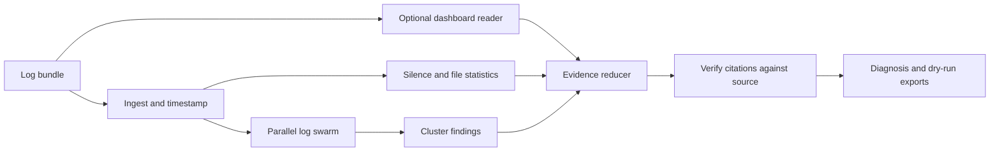

# CrashCart

CrashCart is a hackathon prototype for GPU training incident response. It scans distributed training logs, checks every text citation against the source, compares log evidence with an optional telemetry dashboard, and prepares a postmortem plus a dry-run runbook. Remediation is never executed.

**Demo:** to be added after deployment.

**Video:** to be added after recording.

## Screenshot

Capture and add the final demo screenshot after the local interface has been reviewed on the hackathon presentation display.

The bundled sample incidents are synthetic and clearly labeled in the UI. They are designed to make the workflow reproducible without an API key.

## How it works



## Where each Nemotron model is used

| Role | Configured candidate | Purpose |
|---|---|---|
| Swarm | `LLM_MODEL_SWARM` | Scan one bounded log chunk per worker and return source line citations. |
| Eyes | `LLM_MODEL_EYES` | Read one telemetry dashboard image when configured. |
| Reduce | `LLM_MODEL_REDUCE` | Combine clusters and observations into a diagnosis with evidence. |
| Tail baseline | `LLM_MODEL_BASELINE` | Show the result from looking only at the final 200 lines of rank 000. |
| Skeptic | `LLM_MODEL_SKEPTIC` | Reserved stretch role; not part of the current run. |

The candidate model IDs and prices in `.env.example` have not been confirmed by a live Gate 0 run. Configure only IDs returned by the provider's model list.

## Where Nebius Token Factory accelerated this

The provider client uses the OpenAI-compatible Token Factory endpoint configured in `LLM_BASE_URL`. The full pipeline can run in mock mode without network access. No provider speed or quality result has been measured yet.

| Measurement | Result |
|---|---|
| Live incident evaluation | **not yet measured** |
| Swarm parallel versus sequential timing | **not yet measured** |

## Nebius services used

- **Token Factory:** supported as the live OpenAI-compatible model provider; credentials and model IDs still require the human Gate 0 check.
- **Serverless Endpoints:** not deployed.

## Results

No live evaluation results are recorded yet. The optional evaluation harness labels mock results as workflow checks; they are not provider performance measurements. Once live results are produced, `tools/make_report.py` creates `eval/RESULTS.md` and `eval/chart.png` from `eval/results.json`.

## Synthetic data disclosure

The repository generates 12 synthetic incident bundles using `tools/make_incident.py`. Their dashboards, log content, timestamps, IDs, and planted labels are artificial. Sample-only ground truth is read only by the evaluation harness and the post-run truth badge. User uploads cannot include a `truth.json` file. Do not use the synthetic evaluation as evidence of real-world diagnostic accuracy.

## Setup and run

Python 3.12 is recommended. NumPy is pinned to a version that does not support Python 3.15.

### Windows PowerShell

Run each line from the repository folder:

```powershell
py -3.12 -m venv .venv
.\.venv\Scripts\python.exe -m pip install -r requirements.txt
.\.venv\Scripts\python.exe -m pytest -q
.\.venv\Scripts\python.exe -m uvicorn app.main:app --host 127.0.0.1 --port 8080
```

Open <http://127.0.0.1:8080>. The first start creates any missing synthetic incidents and a mock replay. Stop the local server with `Ctrl+C`.

### macOS or Linux

```bash
python3.12 -m venv .venv
. .venv/bin/activate
python -m pip install -r requirements.txt
python -m pytest -q
python -m uvicorn app.main:app --host 127.0.0.1 --port 8080
```

### Mock and live mode

Mock mode is the default and needs no key. To make live provider calls, copy `.env.example` to `.env`, set `LLM_MODE=live`, add `NEBIUS_API_KEY`, and use model IDs confirmed by `tools/smoke_test.py`. Keep `.env` private. Run `python tools/smoke_test.py` only after configuring a key; it sends provider requests and records its report locally. Never paste the key into chat or commit `.env`.

### Evaluation

The mock workflow evaluation can be run with:

```powershell
.\.venv\Scripts\python.exe tools\run_eval.py --incidents all --systems crashcart,tail,no_eyes --out eval/results.json
.\.venv\Scripts\python.exe tools\make_report.py
```

Live evaluation spends provider tokens. Review the UI cost chip and pass `--full-limit` conservatively before enabling `full_ultra`. Results include their mode so mock scores are not mistaken for model benchmarks.

### Docker

```powershell
docker build -t crashcart:local .
docker run --rm -p 8080:8080 crashcart:local
```

The image defaults to mock mode and needs no secret. For live use, pass `LLM_MODE=live` and a secret through the deployment platform's secret manager. Do not bake keys into the image.

## Limitations

- Evaluation data consists of 12 synthetic incidents; real-world accuracy has not been measured.
- Synthetic dashboard cases do not validate the live vision provider.
- Uploaded bundles are limited to UTF-8 text files, one PNG, 30 MB compressed, 200 MB uncompressed, and 1.2M estimated text tokens.
- The run limiter is in-memory and intended for a single demo instance, not a multi-worker production deployment.
- Runbook actions are suggestions only. CrashCart never executes them.
- The Gate 0 provider check, live evaluation, deployment, and recorded replays require a human-owned API key/account and have not been completed.

## License

MIT. See [LICENSE](LICENSE).
